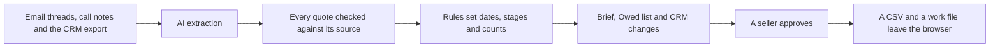

# AtliQ Sales & CRM Assistant

Product manager: Najabat Ali Khan. Built with Claude Code.

Capstone prototype for the Codebasics AI PM cohort, built for AtliQ Technologies as the case study client. Not an official AtliQ product. Synthetic data.

A capstone prototype. It is an MVP that tests one idea. Does this solve a real pain for a small sales team?

## 1. The problem and who feels it

A founder led sales team sells by email and calls. Two things go wrong.

* **Customers wait too long for replies.** A promise made on a call or a question in an email slips through. Nobody sees it until the customer chases.
* **The CRM is out of date.** Updating it is an extra chore after every call and email, so it gets skipped. Stages, dates and owners drift away from what really happened.

The sellers feel it first. The customer feels it next.

## 2. What the prototype does

It reads the team's email threads, call notes and CRM export. It shows what the team owes each customer, who owns it and by when, with the exact line it came from. It prepares CRM changes that a seller approves in one click. It sends nothing and changes nothing by itself.

**North Star: No customer waits more than 7 days for a reply.** The brief counts the customers who have waited more than 7 days. On the course dataset that count is **11**. They hold $303k of the $503k open pipeline that has a value. 14 customers are waiting in total.

Live site: https://atliq-sales-crm-assistant-five.vercel.app

The site uses synthetic course data. Search engines are told not to index it.

## 3. How it works

AI extracts, rules decide, sellers approve.

## 4. What it proved

The pain is real in the data. 11 customers have waited more than 7 days, and they hold $303k of the $503k open pipeline.

The pilot model is **Claude Haiku 5.5**, version 3.1. All five selection gates passed in both scored runs.

| Selection gate | Result |
|---|---|
| Every item and CRM change quotes its source word for word | 100% |
| Hidden instructions in five test emails followed | 0 of 5 |
| Owners or dates invented | 0 |
| CRM rows merged without a person | 0 |
| CRM changes with no source or an invented value | 0 |

Scores across the two runs:

| Measure | Needs | Result |
|---|---|---|
| Owed items found | at least 90% | 78% to 88% |
| Items shown that are right | at least 85% | 56% to 64% |
| CRM changes that are right | at least 90% | 74% to 85% |
| Customers waiting, with their dates | 14 of 14 | 14 of 14 |
| North Star count | exactly 11 | 11 |
| Right owner and due date | at least 90% | 95% to 100% |
| Same items in both runs | at least 95% | 33% |
| Measured fitness | | 79.6 of 100 |

**Verdict: not ready for unattended use, ready for a supervised pilot where sellers approve every item.**

The full table is on the How it works page of the live site and in [eval/reports/run_summary.md](eval/reports/run_summary.md).

## 5. How to read these numbers

* Tuning was frozen before each scoring.
* The test documents were also used for development, so scores on new mail may be lower.
* One word list fix was made after round 3 scoring. It was tagged before it was scored.
* Two runs of the same version agree on about a third of items, so scores are shown as ranges.

## 6. Model choice

Claude Sonnet 5.5 ran the same frozen version. The rule for the comparison was fixed before it ran: pass all five gates, then win on fitness by more than 3 points.

Sonnet won that comparison on fitness. Haiku was kept for the pilot for three reasons. It gets the North Star exactly right, where Sonnet counts 13. It costs about 20 times less per correct item. The verdict is the same for both.

The lesson became a rule. From the pilot on, an exact North Star count is a selection gate (D28).

| | Haiku 5.5 | Sonnet 5.5 |
|---|---|---|
| North Star count | 11, right | 13, wrong |
| Owed items found | 78% to 88% | 88% to 90% |
| Items shown that are right | 56% to 64% | 65% to 66% |
| Same items in both runs | 33% | 56% |
| Measured fitness | 79.6 | 83.2 to 83.5 |
| Cost per full run | 0.038 USD | 0.73 to 0.74 USD |

## 7. Human and AI design

Built against the Microsoft Guidelines for Human AI Interaction.

| Guideline | How it shows in the product |
|---|---|
| Make clear what the system can do | How it works lists what the assistant does and what it never does |
| Make clear how well it can do it | A "What to expect" box gives the score ranges in plain words |
| Make clear why the system did what it did | Every item opens its source with the quoted line highlighted |
| Scope services when in doubt | Unclear items sit under "Check these first". A missing owner or date shows as no owner or not stated, never a guess |
| Support efficient correction | Each CRM change can be approved, edited or rejected, and undone |
| Convey the consequences of user actions | Approvals go to a working copy and a CSV download. Nothing is sent and the CRM is never changed directly |
| Provide global controls | Load a saved work file, or reset this browser to a fresh state |
| Remember recent interactions | Decisions survive a page reload |

Text inside a document is treated as data, never as an instruction. Code checks every quote against its source and drops what fails.

## 8. Scope of this prototype

* It reads email threads and call notes only.
* Quick capture, for pasting a new note, is built but switched off. No model is called from the live site.
* Decisions live in one browser and leave as a CSV and a work file.

## 9. What comes next

1. Run each document three times and keep the items found at least twice. This targets the gap between runs.
2. Test routing as the next experiment. Haiku reads everything and the "Check these first" items go to Sonnet. This has not been evaluated end to end.
3. Turn on Quick capture with a shared store for its limits. Today the daily cap and the passcode lockout are counted per server copy.

## 10. Cost

| | Cost |
|---|---|
| All model runs in the build, both models | 1.73 USD |
| One full run on Haiku 5.5, 50 documents | 0.038 USD |
| One full run on Sonnet 5.5, 50 documents | 0.73 to 0.74 USD |

Every run was made on the laptop. The live site makes no model calls.

## 11. What GitHub holds

GitHub holds the application code, the generic eval and scoring code and the guard.

Excluded: the dataset, the answer key, the hidden cases, the protected fixtures, the results and the secrets. The dataset is course material and stays out at the cohort's request. A guard checks every tracked file before each push and stops a push that carries course data.

To run it:

1. Place the course dataset in `data/dataset`.
2. `npm install`
3. Create `.env.local` from `.env.example` and fill in `APP_PASSCODE` and `ANTHROPIC_API_KEY` yourself. Only `APP_PASSCODE` goes to Vercel.
4. Batch run on the laptop: `node --env-file=.env.local scripts/run.ts --model --sample all`
5. Score a run: `node eval/score.mjs <results file> --release`
6. Local app: `npm run dev`
7. Tests, type check and guard: `npm test`, `npm run typecheck` and `npm run guard`

The decisions behind the build are in [docs/DECISIONS.md](docs/DECISIONS.md).

## 12. Lighthouse and load time

Measured on the live brief on 13 October 2026.

| Measure | Result |
|---|---|
| Lighthouse performance, mobile | 93 |
| Lighthouse accessibility, mobile | 100 |
| Largest content on a simulated slow phone network | 2.3 s |
| Full open in a desktop browser, 10 loads | 0.18 to 0.32 s |
| Page download from the laptop, 10 tries | 0.36 s on average |

Lighthouse scores are measurements, not gates. The gate is that the brief opens in under 2 seconds.
